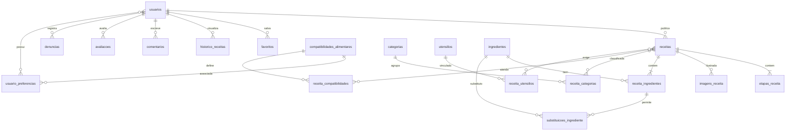

# 🍳 Especificação Técnica e Funcional Final — Cozinha Guiada

> **Documento Consolidado de Requisitos, Arquitetura e Critérios de Aceite**  
> **Status:** Projeto 100% Implementado e Homologado  
> **Versão:** 2.0 (Final - Pós-Desenvolvimento)  
> **Repositório:** [https://github.com/Caju12/Cozinha-Guiada](https://github.com/Caju12/Cozinha-Guiada)

---

## 📌 Sumário Executivo

Este documento consolida a especificação inicial do sistema **Cozinha Guiada**, incorporando integralmente os objetivos, perfis de usuários, requisitos funcionais (RF01 a RF53), requisitos não-funcionais (RNF01 a RNF19), modelo de dados e critérios de aceite (CA01 a CA53). Adicionalmente, detalha todas as **decisões técnicas, refinamentos de segurança e melhorias de usabilidade implementadas ao longo das 8 etapas do ciclo de desenvolvimento**.

---

## 1. Objetivos do Sistema

* **O que é e para quem:** O *Cozinha Guiada* é uma plataforma web inclusiva de receitas culinárias desenvolvida para auxiliar iniciantes na cozinha, especialmente pessoas com pouca experiência, idosos ou pessoas com restrições alimentares severas (intolerâncias, alergias ou escolhas éticas).
* **O que resolve / Como faz:** O sistema elimina a insegurança do cozinheiro novato ao apresentar fichas técnicas completas com parâmetros culinários que receitas tradicionais costumam omitir: temperatura de forno, intensidade da chama do fogão, utensílios necessários e ponto esperado do prato (textura, cor e consistência).
* **Benefício principal:** Além de permitir a busca por ingredientes que o usuário já possui na despensa (reduzindo desperdício), o sistema implementa um **Modo Guiado** imersivo com tela sempre ativa (Screen Wake Lock) e substituições inteligentes de ingredientes para dietas especiais.

---

## 2. Perfis de Usuários (RBAC)

A plataforma adota um modelo hierárquico e seguro de Controle de Acesso Baseado em Papéis (*Role-Based Access Control*):

1. **Usuário Não Cadastrado (Visitante):**
   * Acesso público ao catálogo de receitas ativas.
   * Pesquisa textual livre, busca por despensa e filtros combinados de categorias e dietas inclusivas.
   * Visualização da ficha técnica detalhada da receita, informações do produtor e acesso ao Modo de Preparo Guiado.
   * Não pode favoritar, comentar, avaliar ou publicar receitas.

2. **Usuário Cadastrado (Membro):**
   * Todas as permissões de visitante.
   * Gerenciamento de perfil (dados pessoais, biografia e preferências alimentares salvas).
   * Adicionar e remover receitas de sua lista de Favoritos.
   * Registro automático e consulta de histórico de receitas acessadas, com opção de limpeza total.
   * Avaliação de receitas com notas de 1 a 5 estrelas.
   * Publicação, edição e exclusão de comentários próprios.
   * Envio de denúncias fundamentadas contra receitas ou comentários inadequados.
   * Autossolicitação imediata para se tornar Produtor de Conteúdo.

3. **Produtor de Conteúdo (Chef):**
   * Todas as permissões de usuário cadastrado.
   * Acesso ao Painel do Produtor (`/produtor/painel`).
   * Construtor dinâmico de receitas com cadastro de ingredientes, medidas, unidades, opções de substituição inclusiva, utensílios e passos sequenciais de preparo.
   * Upload de fotografias reais do prato (JPG, PNG, WEBP).
   * Controle de visibilidade: alternar receitas entre Pública e Privada (rascunho).
   * Edição completa e exclusão definitiva de receitas de sua autoria.
   * Perfil público com biografia e portfólio de receitas publicadas.

4. **Administrador:**
   * Todas as permissões anteriores.
   * Painel Administrativo Geral (`/admin`) com métricas em tempo real (total de usuários, produtores, receitas públicas, denúncias pendentes e avaliações).
   * Gestão de usuários: ativação/bloqueio de contas e promoção/rebaixamento de perfis RBAC.
   * Moderação de denúncias: análise de conteúdo denunciado com remoção definitiva do ar ou descarte fundamentado.
   * Gestão completa (CRUD) de categorias oficiais do catálogo.

---

## 3. Matriz de Casos de Uso Principais

| Perfil | Casos de Uso Abrangidos | Requisitos Funcionais |
| :--- | :--- | :---: |
| **Visitante** | Consultar catálogo; pesquisar por título; filtrar por categoria e dietas; buscar por despensa; visualizar ficha técnica, utensílios e substituições; executar Modo Guiado; cadastrar-se; autenticar-se. | RF01 a RF03, RF08 a RF19 |
| **Usuário Cadastrado** | Ações de visitante; editar perfil e bio; selecionar preferências alimentares; gerenciar favoritos; consultar e limpar histórico; avaliar receitas (1-5); comentar receitas (criar/editar/excluir); denunciar conteúdo; tornar-se produtor. | RF04 a RF07, RF20 a RF30 |
| **Produtor** | Ações de cadastrado; painel de publicações; criar, editar e excluir receitas; cadastrar ingredientes, unidades e substituições; ordenar etapas; informar parâmetros culinários (fogo, temperatura, ponto); upload de fotos; alternar visibilidade pública/privada. | RF31 a RF45, RF53 |
| **Administrador** | Ações gerais; dashboard de métricas; listar, bloquear e reativar usuários; alterar papéis RBAC; fila de moderação de denúncias; remoção de conteúdos infratores; CRUD de categorias culinárias. | RF46 a RF52 |

---

## 4. Requisitos Funcionais (RF01 a RF53)

### Acesso, Cadastro e Perfil
* **RF01:** O sistema deverá permitir que visitantes acessem e visualizem as receitas públicas disponíveis na plataforma.
* **RF02:** O sistema deverá permitir que visitantes realizem pesquisas por receitas.
* **RF03:** O sistema deverá permitir que visitantes utilizem filtros para refinar a busca por receitas.
* **RF04:** O sistema deverá permitir que visitantes criem uma conta na plataforma.
* **RF05:** O sistema deverá permitir que usuários cadastrados realizem login.
* **RF06:** O sistema deverá permitir que usuários cadastrados gerenciem seus dados de perfil.
* **RF07:** O sistema deverá permitir que usuários cadastrados configurem e atualizem suas preferências alimentares, selecionando uma ou mais das seguintes opções: vegetariana, vegana, sem lactose e sem glúten.

### Pesquisa e Descoberta de Receitas
* **RF08:** O sistema deverá permitir que usuários pesquisem receitas utilizando os ingredientes disponíveis na despensa.
* **RF09:** O sistema deverá permitir que usuários utilizem diferentes critérios de pesquisa simultaneamente.
* **RF10:** O sistema deverá permitir que usuários filtrem receitas de acordo com as opções alimentares vegetariana, vegana, sem lactose e sem glúten.
* **RF11:** O sistema deverá apresentar receitas que correspondam a todos os filtros alimentares selecionados pelo usuário (relação lógica "E" / AND estrita).
* **RF12:** O sistema deverá permitir que usuários visualizem os detalhes das receitas, incluindo ingredientes, quantidades, modo de preparo e compatibilidades alimentares informadas.
* **RF13:** O sistema deverá permitir que usuários consultem alternativas cadastradas para ingredientes de uma receita, quando disponíveis.

### Modo de Preparo
* **RF14:** O sistema deverá apresentar os ingredientes, quantidades e unidades utilizadas em cada receita.
* **RF15:** O sistema deverá apresentar as etapas do modo de preparo de forma organizada e sequencial.
* **RF16:** O sistema deverá apresentar informações sobre o tempo de preparo e os utensílios necessários para a execução da receita.
* **RF17:** O sistema deverá apresentar informações adicionais de preparo, como temperatura, intensidade do fogo e ponto esperado, quando disponíveis.
* **RF18:** O sistema deverá disponibilizar um modo de preparo guiado para auxiliar o usuário durante a execução da receita.
* **RF19:** O sistema deverá manter a tela ativa enquanto o modo de preparo guiado estiver sendo utilizado.

### Favoritos, Histórico e Interação Social
* **RF20:** O sistema deverá permitir que usuários cadastrados adicionem receitas aos seus favoritos.
* **RF21:** O sistema deverá permitir que usuários cadastrados removam receitas de seus favoritos.
* **RF22:** O sistema deverá permitir que usuários cadastrados consultem suas receitas favoritas.
* **RF23:** O sistema deverá registrar o histórico de receitas visualizadas pelos usuários cadastrados.
* **RF24:** O sistema deverá permitir que usuários cadastrados consultem e limpem seu histórico de receitas.
* **RF25:** O sistema deverá permitir que usuários cadastrados realizem comentários nas receitas.
* **RF26:** O sistema deverá permitir que usuários cadastrados editem seus próprios comentários.
* **RF27:** O sistema deverá permitir que usuários cadastrados excluam seus próprios comentários.
* **RF28:** O sistema deverá permitir que usuários cadastrados avaliem as receitas disponíveis com notas de 1 a 5 e calcule a média.
* **RF29:** O sistema deverá permitir que usuários cadastrados denunciem receitas ou comentários que estejam em desacordo com as regras da plataforma.

### Produção de Conteúdo
* **RF30:** O sistema deverá permitir que usuários cadastrados se tornem produtores de conteúdo.
* **RF31:** O sistema deverá permitir que produtores de conteúdo criem novas receitas.
* **RF32:** O sistema deverá permitir que produtores de conteúdo adicionem ingredientes, quantidades e unidades às suas receitas.
* **RF33:** O sistema deverá permitir que produtores de conteúdo adicionem e organizem as etapas do modo de preparo.
* **RF34:** O sistema deverá permitir que produtores de conteúdo adicionem informações como tempo de preparo, utensílios, temperatura, intensidade do fogo e ponto de preparo às suas receitas.
* **RF35:** O sistema deverá permitir que produtores de conteúdo adicionem imagens às suas receitas.
* **RF36:** O sistema deverá permitir que produtores de conteúdo personalizem a apresentação de suas receitas por meio da edição do título, da descrição e das imagens.
* **RF37:** O sistema deverá permitir que produtores de conteúdo visualizem e gerenciem suas próprias publicações em painel exclusivo.
* **RF38:** O sistema deverá permitir que produtores de conteúdo editem suas próprias receitas.
* **RF39:** O sistema deverá permitir que produtores de conteúdo excluam suas próprias receitas com integridade referencial.
* **RF40:** O sistema deverá permitir que produtores de conteúdo definam suas publicações como públicas ou privadas.
* **RF41:** O sistema deverá permitir que produtores de conteúdo selecionem manualmente as compatibilidades alimentares de suas receitas entre as opções vegetariana, vegana, sem lactose e sem glúten.
* **RF42:** O sistema deverá permitir que produtores de conteúdo alterem as compatibilidades alimentares de suas próprias receitas.
* **RF43:** O sistema deverá permitir que produtores de conteúdo cadastrem alternativas de substituição para ingredientes de suas próprias receitas.
* **RF44:** O sistema deverá permitir que produtores de conteúdo cadastrem proporção e instruções para as alternativas de substituição.
* **RF45:** O sistema deverá permitir que produtores de conteúdo removam alternativas de substituição cadastradas em suas receitas.

### Administração e Moderação
* **RF46:** O sistema deverá permitir que administradores visualizem e gerenciem os usuários cadastrados (ativar/bloquear).
* **RF47:** O sistema deverá permitir que administradores gerenciem o papel dos usuários e produtores de conteúdo.
* **RF48:** O sistema deverá permitir que administradores visualizem métricas e estatísticas gerais da plataforma.
* **RF49:** O sistema deverá permitir que administradores moderem receitas e comentários.
* **RF50:** O sistema deverá permitir que administradores removam conteúdos que estejam em desacordo com as regras da plataforma.
* **RF51:** O sistema deverá permitir que administradores gerenciem as categorias utilizadas para organizar as receitas (CRUD).
* **RF52:** O sistema deverá permitir que administradores visualizem e gerenciem a fila de denúncias pendentes e resolvidas.
* **RF53:** O sistema deverá permitir que usuários visualizem as informações públicas dos produtores responsáveis pelas receitas (bio e portfólio).

---

## 5. Requisitos Não-Funcionais (RNF01 a RNF19)

* **RNF01:** O sistema deve possuir uma interface simples, organizada e de fácil compreensão para os usuários.
* **RNF02:** O sistema deve apresentar uma navegação clara e consistente entre suas páginas e funcionalidades.
* **RNF03:** O sistema deve ser responsivo, permitindo sua utilização em computadores, tablets e smartphones.
* **RNF04:** O sistema deverá apresentar os resultados das pesquisas por receitas em até 3 segundos, em condições normais no ambiente local de execução (tempo medido nos testes: 2ms a 60ms).
* **RNF05:** O sistema deve validar todos os dados enviados pelos formulários no servidor antes de armazená-los ou processá-los.
* **RNF06:** As senhas dos usuários devem ser armazenadas de forma protegida com hash seguro (`BCRYPT`), nunca em texto puro.
* **RNF07:** O sistema deve utilizar autenticação por sessão segura (`Session.php`) para controlar o acesso às funcionalidades protegidas.
* **RNF08:** O sistema deve verificar as permissões do usuário no servidor (RBAC via `AuthMiddleware`) antes de permitir o acesso a funcionalidades restritas.
* **RNF09:** O sistema deve impedir que usuários alterem ou excluam conteúdos pertencentes a outros usuários sem autorização (verificação estrita de posse com HTTP 403).
* **RNF10:** O sistema deve encerrar a sessão do usuário de forma segura após a realização do logout, com destruição de cookies.
* **RNF11:** O sistema deve tratar e validar os dados recebidos antes de armazená-los, prevenindo injeções de SQL (Prepared Statements PDO) e XSS (`strip_tags` / `htmlspecialchars`).
* **RNF12:** O sistema não deve apresentar informações técnicas, senhas ou detalhes internos do banco de dados em mensagens de erro exibidas aos usuários.
* **RNF13:** O sistema deve restringir o acesso aos dados pessoais dos usuários somente às funcionalidades e usuários autorizados, garantindo unicidade de e-mail.
* **RNF14:** O sistema deve manter a integridade e a consistência dos dados cadastrados por meio de chaves estrangeiras com `ON DELETE CASCADE`.
* **RNF15:** O sistema deve apresentar de forma clara as opções de compatibilidade alimentar e oferecer usabilidade touch-friendly e foco por teclado.
* **RNF16:** O sistema deve utilizar textos, botões e campos visuais claros, com tratamento gracioso de rotas inexistentes (HTTP 404 customizado).
* **RNF17:** O sistema deve apresentar mensagens claras ao usuário (notificações flash de sucesso, erro e aviso) quando uma operação for concluída ou recusada.
* **RNF18:** O sistema deve possuir uma estrutura modular que facilite sua manutenção e evolução futura (Arquitetura padrão MVC em PHP).
* **RNF19:** O sistema deve permitir a inclusão de novas opções de compatibilidade alimentar sem exigir alterações em código ou no esquema do banco de dados (tabela normalizada N:N).

---

## 6. Modelo de Dados Físico Normalizado (19 Tabelas)

O banco de dados foi normalizado na 3ª Forma Normal (3FN), estruturado no banco `cozinha_guiada` (charset `utf8mb4_unicode_ci`):



### Relação Completa de Tabelas Físicas:
1. `usuarios`: Contas de acesso, dados cadastrais, hash de senha, papel RBAC, status de ativação e biografia.
2. `compatibilidades_alimentares`: Dietas inclusivas oficiais (Vegetariana, Vegana, Sem lactose, Sem glúten).
3. `usuario_preferencias`: Tabela N:N vinculando preferências aos usuários.
4. `categorias`: Categorias culinárias gerenciadas pelo admin (Bolos e Tortas, Massas, Sobremesas, etc.).
5. `receitas`: Entidade principal com dados técnicos (tempo, porções, temperatura, chama, ponto esperado, visibilidade).
6. `receita_categorias`: Tabela N:N vinculando receitas às categorias.
7. `receita_compatibilidades`: Tabela N:N vinculando receitas às dietas inclusivas atendidas.
8. `utensilios`: Catálogo de equipamentos de cozinha (Liquidificador, Forno, Espátula, etc.).
9. `receita_utensilios`: Tabela N:N vinculando utensílios necessários à receita.
10. `ingredientes`: Catálogo padronizado de insumos alimentícios.
11. `receita_ingredientes`: Vínculo N:N contendo quantidade, unidade de medida e observação de preparo.
12. `substituicoes_ingrediente`: Alternativas inclusivas de substituição por ingrediente de cada receita, com proporção e orientações.
13. `etapas_receita`: Passos sequenciais ordenados com descrição clara para o cozinheiro.
14. `imagens_receita`: URLs relativas das fotos da receita com flag de imagem principal.
15. `favoritos`: Registro único N:N de receitas marcadas com coração por cada usuário.
16. `historico_receitas`: Log de visualizações de receitas com atualização automática de timestamp.
17. `comentarios`: Mensagens de feedback de usuários, com controle de status (ativo/removido).
18. `avaliacoes`: Notas de 1 a 5 estrelas atribuídas por usuários únicos por receita.
19. `denuncias`: Fila de moderação para receitas ou comentários reportados, com controle de resolução.

---

## 7. Critérios de Aceite Homologados (CA01 a CA53)

Todos os 53 critérios de aceite descritos na especificação inicial foram codificados em formato BDD (*Given-When-Then*) e validados por suítes de testes automatizados:

* **CA01 — Acesso às receitas públicas:** Visitante acessa e visualiza receitas ativas sem necessidade de autenticação.
* **CA02 — Pesquisa de receitas:** Visitante pesquisa por termos livres e o catálogo retorna resultados condizentes.
* **CA03 — Filtros de pesquisa:** O sistema refina os resultados conforme categorias selecionadas.
* **CA04 — Criação de conta:** Cadastro público gera usuário comum com perfil `cadastrado` e status ativo.
* **CA05 — Login:** Autenticação com credenciais válidas cria sessão segura; rejeita senhas incorretas.
* **CA06 — Gerenciamento do perfil:** Usuário autenticado atualiza nome e biografia com persistência no banco.
* **CA07 — Preferências alimentares:** Usuário seleciona suas restrições e o sistema mantém o vínculo atualizado.
* **CA08 — Busca por ingredientes disponíveis:** Usuário informa o que tem na despensa e o sistema encontra receitas compatíveis.
* **CA09 — Múltiplos critérios de pesquisa:** Busca textual, categoria e dietas combinam-se harmoniosamente.
* **CA10 — Filtro por compatibilidade alimentar:** O sistema filtra receitas pelas opções alimentares selecionadas.
* **CA11 — Pesquisa estrita por compatibilidade:** Se o usuário seleciona mais de uma restrição, o sistema retorna **apenas** receitas que cumprem todas elas (relação lógica E).
* **CA12 — Visualização dos detalhes da receita:** Exibe ingredientes, modo de preparo, tempo e restrições.
* **CA13 — Alternativas de ingredientes:** Exibe opções inclusivas cadastradas para substituir ingredientes específicos.
* **CA14 — Ingredientes e quantidades:** Apresenta quantidades e unidades de medida de forma legível.
* **CA15 — Etapas do preparo:** Exibe etapas ordenadas sequencialmente (1, 2, 3...).
* **CA16 — Tempo e utensílios:** Exibe tempo estimado em minutos e lista visual de utensílios necessários.
* **CA17 — Informações adicionais:** Exibe temperatura do forno, intensidade da chama e ponto esperado do prato.
* **CA18 — Modo de preparo guiado:** Interface imersiva passo a passo com botões amplos e barra de progresso.
* **CA19 — Tela ativa (Wake Lock):** Mantém a tela ligada durante todo o modo guiado via API nativa do navegador.
* **CA20 a CA22 — Favoritos:** Adiciona, lista em página dedicada e remove receitas dos favoritos.
* **CA23 e CA24 — Histórico:** Grava visualizações automaticamente, lista histórico recente e permite limpeza com um clique.
* **CA25 a CA27 — Comentários:** Publicação, edição e exclusão de comentários com controle rigoroso de posse (RNF09).
* **CA28 — Avaliação de receitas:** Aceita notas de 1 a 5 estrelas, impede valores fora da faixa e calcula a média ponderada.
* **CA29 — Denúncia de conteúdo:** Grava denúncia com motivo na fila administrativa com status inicial `pendente`.
* **CA30 — Tornar-se produtor:** Usuário cadastrado solicita transição de perfil e recebe status de produtor imediatamente.
* **CA31 a CA39 — Gestão de receitas do produtor:** Criação completa, edição, inclusão de etapas, ingredientes, fotos e exclusão com integridade.
* **CA40 — Visibilidade:** Alterna receita entre status pública e privada, ocultando privadas do catálogo geral.
* **CA41 e CA42 — Compatibilidades da receita:** Produtor associa e edita compatibilidades alimentares de seus pratos.
* **CA43 a CA45 — Gestão de substituições:** Produtor adiciona, edita e remove sugestões de ingredientes alternativos com proporções.
* **CA46 e CA47 — Gestão administrativa de usuários:** Bloqueio e reativação de contas e promoção de papéis RBAC.
* **CA48 — Métricas administrativas:** Dashboard exibe totalizadores consolidados de receitas, usuários, avaliações e moderação.
* **CA49 e CA50 — Moderação:** Administrador oculta/remove comentários ou receitas que violam regras.
* **CA51 — CRUD de categorias:** Administrador cria, edita nome/slug e remove categorias oficiais.
* **CA52 — Fila de denúncias:** Fila para resolução administrativa com status `conteudo_removido` ou `descartada`.
* **CA53 — Informações do produtor:** Página pública exibindo biografia, foto/avatar e catálogo de receitas do autor.

---

## 8. Mudanças e Decisões Técnicas Adotadas no Desenvolvimento

Durante a execução prática do projeto, foram realizadas evoluções e decisões técnicas essenciais que aprimoraram a especificação inicial:

### 8.1. Resolução do Conflito de Stack Tecnológico
* **Spec Inicial vs Sugestões Iniciais:** Na análise preliminar da especificação, foi identificada a incompatibilidade de usar *Prisma ORM, PostgreSQL e Vercel* com o escopo de *PHP + MariaDB no XAMPP* exigido pelo projeto acadêmico.
* **Decisão Adotada:** Fidelidade integral à especificação oficial (**Caminho A: PHP 8.2 + MySQL/MariaDB + Apache no XAMPP**), garantindo compatibilidade nativa com o ambiente local de apresentação sem dependência de nuvem.

### 8.2. Arquitetura Modular Padrão MVC em PHP
* Implementada separação limpa de responsabilidades:
  - `src/Controllers`: Lógica de rotas e orquestração de requisições.
  - `src/Models`: Consultas SQL seguras e relacionamentos.
  - `src/Services`: Upload seguro de mídias (`UploadService`) e lógica de autenticação (`AuthService`).
  - `src/Utils`: Gerenciamento seguro de sessão (`Session`) e validação/sanitização (`Validator`).
  - `views/`: Camada de apresentação em templates PHP puros organizados por domínio.
  - `public/`: Front Controller único (`index.php`), assets e regras de reescrita Apache ([`.htaccess`](Cozinha%20Guiada/public/.htaccess)).

### 8.3. Prevenção Contra Bloqueio do Administrador (*Lockout*)
* **Mudança de Segurança:** Implementada regra rígida na alteração de papéis e no bloqueio de contas: o sistema impede que o último administrador ativo desative a si próprio ou altere seu perfil para membro comum, evitando o travamento irreversível do painel de administração.

### 8.4. Algoritmo SQL Estrito para Compatibilidades Múltiplas (RF11)
* **Solução Técnica:** Para garantir que a seleção de múltiplas dietas (ex: *Vegana* **E** *Sem Glúten* **E** *Sem Lactose*) não retorne receitas que possuam apenas uma delas (comportamento "OU"), a query utiliza agrupamento com contagem distintiva estrita:
  ```sql
  SELECT r.id FROM receitas r
  JOIN receita_compatibilidades rc ON r.id = rc.receita_id
  WHERE rc.compatibilidade_id IN (:comp1, :comp2, :comp3)
  GROUP BY r.id
  HAVING COUNT(DISTINCT rc.compatibilidade_id) = 3
  ```

### 8.5. Aprimoramento do Modo Guiado e Screen Wake Lock (RF18, RF19)
* **Reaquisição Automática de Wake Lock:** Em dispositivos móveis, quando o usuário muda de aba ou o navegador minimiza, o Wake Lock é automaticamente revogado pelo sistema operacional. O script [`guided-mode.js`](Cozinha%20Guiada/public/js/guided-mode.js) adicionou um *listener* no evento `visibilitychange` para readquirir a trava de tela assim que o app volta ao foco.
* **Temporizador com Áudio Sintetizado Nativo:** Adicionado temporizador culinário com alertas sonoros gerados diretamente pela **Web Audio API** (`AudioContext`), eliminando a necessidade de arquivos de som externos que poderiam falhar no carregamento.
* **Navegação por Teclado:** Implementados atalhos de teclado (Setas e Barra de Espaço) para que o cozinheiro possa operar o cronômetro e mudar de etapa sem tocar no mouse/touchscreen com as mãos molhadas.

### 8.6. Remoção de Metadados Técnicos da Interface do Usuário
* **Polimento Visual:** Todas as menções e códigos técnicos de requisitos (como `RF33`, `RF17`, `RNF06` e tags de depuração) foram removidos dos títulos, rótulos e elementos visíveis da interface gráfica, mantendo o design 100% voltado ao usuário final e profissional.

### 8.7. Recursos de Acessibilidade e Estilo de Impressão
* **Menu Mobile Responsivo:** Desenvolvido menu hambúrguer dinâmico em JavaScript puro para dispositivos móveis, garantindo navegação completa em qualquer resolução.
* **Folha de Estilo para Impressão (`@media print`):** Ao acionar a impressão do navegador (`Ctrl+P`), o sistema oculta cabeçalho, rodapé, temporizadores e botões interativos, gerando uma ficha técnica limpa e econômica para papel.
* **Foco Visível Acessível:** Implementado contorno `:focus-visible` com alto contraste para atender usuários que utilizam navegadores por teclado.

---

## 9. Suíte de Verificação e Homologação dos Testes

O projeto conta com **8 suítes automatizadas de testes** executadas via CLI do PHP, abrangendo banco de dados, regras de negócio e renderização das páginas:

```bash
php tests/run_all_tests.php
```

| Suíte de Testes | Foco de Cobertura | Status | Asserções |
| :--- | :--- | :---: | :---: |
| [`test_etapa2.php`](Cozinha%20Guiada/tests/test_etapa2.php) | Autenticação, hash BCRYPT, registro com preferências e RBAC | ✅ Aprovado | 15/15 |
| [`test_etapa3.php`](Cozinha%20Guiada/tests/test_etapa3.php) | Catálogo, busca textual, filtro estrito "E" (AND) e perfil público | ✅ Aprovado | 19/19 |
| [`test_etapa4.php`](Cozinha%20Guiada/tests/test_etapa4.php) | Modo Guiado, API Screen Wake Lock e Temporizador | ✅ Aprovado | 19/19 |
| [`test_etapa5.php`](Cozinha%20Guiada/tests/test_etapa5.php) | Favoritos, histórico, avaliações (1-5), comentários e denúncias | ✅ Aprovado | 12/12 |
| [`test_etapa6.php`](Cozinha%20Guiada/tests/test_etapa6.php) | Painel do produtor, upload seguro, receitas dinâmicas e substituições | ✅ Aprovado | 15/15 |
| [`test_etapa7.php`](Cozinha%20Guiada/tests/test_etapa7.php) | Painel admin, prevenção de lockout, moderação e CRUD de categorias | ✅ Aprovado | 15/15 |
| [`test_etapa8_final.php`](Cozinha%20Guiada/tests/test_etapa8_final.php) | Validações anti-XSS, sigilo de senhas (RNF12) e integridade 19 tabelas | ✅ Aprovado | 14/14 |
| [`test_routes.php`](Cozinha%20Guiada/tests/test_routes.php) | Validação de renderização HTTP 200/404 de todas as 19 rotas web | ✅ Aprovado | 19/19 |
| **Total Consolidado** | **Cobertura integral de todos os RFs e RNFs** | **100% OK** | **128 / 128** |

---

## 10. Conclusão e Entrega

A especificação técnica final atesta que o sistema **Cozinha Guiada** foi desenvolvido em estrita conformidade com os requisitos estipulados no projeto original, incorporando melhorias de arquitetura, segurança cibernética e usabilidade culinária. 

O software encontra-se totalmente operacional, com dados de teste pré-carregados, documentação detalhada e suíte completa de homologação pronta para demonstração e avaliação escolar.


---

## 11. Ambiente, versões e dependências

- **Pasta efetiva da aplicação:** `Cozinha Guiada/` (o código não está diretamente na raiz do repositório).
- **Backend:** PHP. O README do projeto declara PHP 8.1 ou superior; a especificação técnica indica PHP 8.2. Para reproduzir o ambiente documentado, recomenda-se PHP 8.2. A versão exata do PHP usada nos testes originais não está registrada por saída de terminal no repositório.
- **Banco:** MySQL ou MariaDB, mecanismo InnoDB e charset `utf8mb4`. A versão específica do servidor SQL não está fixada nos arquivos atuais; confirme-a no ambiente de apresentação.
- **Servidor web:** Apache pelo XAMPP ou servidor embutido do PHP para desenvolvimento.
- **Sistema operacional documentado:** Windows, pois o README inclui comandos PowerShell e caminho `C:\\xampp`. A versão exata do Windows e testes em Linux/macOS não estão documentados.
- **Extensões PHP necessárias identificadas no código:** PDO, PDO MySQL (`pdo_mysql`) e Fileinfo (`fileinfo`, para validação MIME dos uploads). Sessões são fornecidas pelo PHP.
- **Dependências PHP/JavaScript:** não há `composer.json` nem `package.json` na árvore atual; não há instalação de dependências via Composer ou npm documentada. O README informa uso de Tailwind CSS via CDN.
- **Arquivos de configuração:** `.env` é lido pela aplicação a partir da pasta `Cozinha Guiada/`. O exemplo está em `Cozinha Guiada/.env.example`.

## 12. Instalação e execução a partir de um clone limpo

Os comandos abaixo devem ser executados dentro da pasta `Cozinha Guiada/`, depois de clonar o repositório privado.

1. Clone o repositório com uma conta GitHub autorizada:

   ```bash
   git clone https://github.com/Caju12/Cozinha-Guiada.git
   cd Cozinha-Guiada
   cd "Cozinha Guiada"
   ```

2. Copie o exemplo de ambiente para o arquivo local:

   **PowerShell:**
   ```powershell
   Copy-Item .env.example .env
   ```

   **Prompt de Comando:**
   ```bat
   copy .env.example .env
   ```

3. Edite `.env` e informe host, porta, banco, usuário e senha do MySQL/MariaDB. Em uma instalação XAMPP local padrão, o usuário costuma ser `root` e a senha pode estar vazia; isso depende da configuração local e não deve ser usado como configuração de produção.

4. Inicie MySQL/MariaDB no painel do XAMPP. A conta informada em `.env` precisa ter permissão para criar o banco `cozinha_guiada` e suas tabelas.

5. Execute o instalador de banco de dados a partir da pasta `Cozinha Guiada/`:

   ```bash
   php database/setup.php
   ```

   No XAMPP para Windows, se o PHP não estiver no PATH:

   ```powershell
   & "C:\\xampp\\php\\php.exe" database\\setup.php
   ```

   O script executa `database/schema.sql` e `database/seed.sql`, criando as 19 tabelas e inserindo dados de demonstração. **Atenção:** `schema.sql` contém comandos `DROP TABLE IF EXISTS`; não execute novamente em uma base com dados que deseja preservar, pois as tabelas existentes são removidas e recriadas.

6. Inicie o servidor de desenvolvimento a partir da pasta `Cozinha Guiada/`:

   ```bash
   php -S 127.0.0.1:8000 -t public public/index.php
   ```

   No XAMPP, também é possível configurar o Apache para usar `Cozinha Guiada/public/` como DocumentRoot e habilitar `mod_rewrite` para as rotas amigáveis.

7. Abra [http://127.0.0.1:8000](http://127.0.0.1:8000). O diretório `public/uploads/receitas/` é criado pelo serviço de upload quando necessário; o processo PHP/Apache precisa ter permissão de escrita nele.

## 13. Variáveis de ambiente

O arquivo `Cozinha Guiada/.env.example` contém somente valores de exemplo. Crie uma cópia chamada `.env` e nunca envie o arquivo real com credenciais ao GitHub.

| Variável | Finalidade | Exemplo |
|---|---|---|
| `DB_HOST` | Endereço do servidor MySQL/MariaDB | `127.0.0.1` |
| `DB_PORT` | Porta TCP do banco | `3306` |
| `DB_NAME` | Nome do banco utilizado | `cozinha_guiada` |
| `DB_USER` | Usuário do banco | `root` |
| `DB_PASS` | Senha do usuário do banco | vazia em XAMPP local sem senha; defina a sua senha quando aplicável |
| `UPLOAD_MAX_SIZE` | Limite de upload em bytes | `5242880` (5 MiB) |
| `ALLOWED_IMAGE_TYPES` | MIME types aceitos no upload | `image/jpeg,image/png,image/webp` |

## 14. Banco de dados: campos, chaves primárias e estrangeiras

A estrutura abaixo foi extraída de `Cozinha Guiada/database/schema.sql`. Tipos, nulabilidade e restrições devem ser conferidos no script SQL, que é a fonte definitiva.

### `usuarios`
- **Campos:** `id` (INT AUTO_INCREMENT PRIMARY KEY); `nome` (VARCHAR(120) NOT NULL); `email` (VARCHAR(180) NOT NULL UNIQUE); `senha` (VARCHAR(255) NOT NULL); `perfil` (ENUM('visitante', 'cadastrado', 'produtor', 'administrador') NOT NULL DEFAULT 'cadastrado'); `bio` (TEXT NULL); `ativo` (TINYINT(1) NOT NULL DEFAULT 1); `criado_em` (TIMESTAMP DEFAULT CURRENT_TIMESTAMP); `atualizado_em` (TIMESTAMP DEFAULT CURRENT_TIMESTAMP ON UPDATE CURRENT_TIMESTAMP).
- **Chave primária:** id.
- **Chaves estrangeiras:** não possui.

### `compatibilidades_alimentares`
- **Campos:** `id` (INT AUTO_INCREMENT PRIMARY KEY); `nome` (VARCHAR(60) NOT NULL UNIQUE); `slug` (VARCHAR(60) NOT NULL UNIQUE); `descricao` (VARCHAR(255) NULL).
- **Chave primária:** id.
- **Chaves estrangeiras:** não possui.

### `usuario_preferencias`
- **Campos:** `usuario_id` (INT NOT NULL); `compatibilidade_id` (INT NOT NULL).
- **Chave primária:** usuario_id,compatibilidade_id.
- **Chaves estrangeiras:** usuario_id → `usuarios`(id), ON DELETE CASCADE; compatibilidade_id → `compatibilidades_alimentares`(id), ON DELETE CASCADE

### `categorias`
- **Campos:** `id` (INT AUTO_INCREMENT PRIMARY KEY); `nome` (VARCHAR(80) NOT NULL UNIQUE); `slug` (VARCHAR(80) NOT NULL UNIQUE); `descricao` (VARCHAR(255) NULL); `criado_em` (TIMESTAMP DEFAULT CURRENT_TIMESTAMP).
- **Chave primária:** id.
- **Chaves estrangeiras:** não possui.

### `receitas`
- **Campos:** `id` (INT AUTO_INCREMENT PRIMARY KEY); `usuario_id` (INT NOT NULL); `titulo` (VARCHAR(150) NOT NULL); `descricao` (TEXT NOT NULL); `tempo_preparo_minutos` (INT NOT NULL DEFAULT 0); `rendimento` (VARCHAR(60) NULL); `temperatura` (VARCHAR(50) NULL); `intensidade_fogo` (VARCHAR(50) NULL); `ponto_esperado` (VARCHAR(120) NULL); `visibilidade` (ENUM('publica', 'privada') NOT NULL DEFAULT 'publica'); `status_moderacao` (ENUM('ativo', 'removido') NOT NULL DEFAULT 'ativo'); `criado_em` (TIMESTAMP DEFAULT CURRENT_TIMESTAMP); `atualizado_em` (TIMESTAMP DEFAULT CURRENT_TIMESTAMP ON UPDATE CURRENT_TIMESTAMP).
- **Chave primária:** id.
- **Chaves estrangeiras:** usuario_id → `usuarios`(id), ON DELETE CASCADE

### `etapas_receita`
- **Campos:** `id` (INT AUTO_INCREMENT PRIMARY KEY); `receita_id` (INT NOT NULL); `ordem` (INT NOT NULL DEFAULT 1); `descricao` (TEXT NOT NULL).
- **Chave primária:** id.
- **Chaves estrangeiras:** receita_id → `receitas`(id), ON DELETE CASCADE

### `imagens_receita`
- **Campos:** `id` (INT AUTO_INCREMENT PRIMARY KEY); `receita_id` (INT NOT NULL); `caminho` (VARCHAR(255) NOT NULL); `ordem` (INT NOT NULL DEFAULT 1); `criado_em` (TIMESTAMP DEFAULT CURRENT_TIMESTAMP).
- **Chave primária:** id.
- **Chaves estrangeiras:** receita_id → `receitas`(id), ON DELETE CASCADE

### `ingredientes`
- **Campos:** `id` (INT AUTO_INCREMENT PRIMARY KEY); `nome` (VARCHAR(100) NOT NULL UNIQUE).
- **Chave primária:** id.
- **Chaves estrangeiras:** não possui.

### `receita_ingredientes`
- **Campos:** `id` (INT AUTO_INCREMENT PRIMARY KEY); `receita_id` (INT NOT NULL); `ingrediente_id` (INT NOT NULL); `quantidade` (DECIMAL(10, 2) NULL); `unidade` (VARCHAR(50) NULL); `observacao` (VARCHAR(120) NULL).
- **Chave primária:** id.
- **Chaves estrangeiras:** receita_id → `receitas`(id), ON DELETE CASCADE; ingrediente_id → `ingredientes`(id), ON DELETE CASCADE

### `substituicoes_ingrediente`
- **Campos:** `id` (INT AUTO_INCREMENT PRIMARY KEY); `receita_ingrediente_id` (INT NOT NULL); `ingrediente_substituto_id` (INT NULL); `texto_substituto` (VARCHAR(150) NOT NULL); `proporcao` (VARCHAR(100) NULL); `observacao` (TEXT NULL).
- **Chave primária:** id.
- **Chaves estrangeiras:** receita_ingrediente_id → `receita_ingredientes`(id), ON DELETE CASCADE; ingrediente_substituto_id → `ingredientes`(id), ON DELETE SET NULL

### `utensilios`
- **Campos:** `id` (INT AUTO_INCREMENT PRIMARY KEY); `nome` (VARCHAR(100) NOT NULL UNIQUE).
- **Chave primária:** id.
- **Chaves estrangeiras:** não possui.

### `receita_utensilios`
- **Campos:** `receita_id` (INT NOT NULL); `utensilio_id` (INT NOT NULL).
- **Chave primária:** receita_id,utensilio_id.
- **Chaves estrangeiras:** receita_id → `receitas`(id), ON DELETE CASCADE; utensilio_id → `utensilios`(id), ON DELETE CASCADE

### `receita_compatibilidades`
- **Campos:** `receita_id` (INT NOT NULL); `compatibilidade_id` (INT NOT NULL).
- **Chave primária:** receita_id,compatibilidade_id.
- **Chaves estrangeiras:** receita_id → `receitas`(id), ON DELETE CASCADE; compatibilidade_id → `compatibilidades_alimentares`(id), ON DELETE CASCADE

### `receita_categorias`
- **Campos:** `receita_id` (INT NOT NULL); `categoria_id` (INT NOT NULL).
- **Chave primária:** receita_id,categoria_id.
- **Chaves estrangeiras:** receita_id → `receitas`(id), ON DELETE CASCADE; categoria_id → `categorias`(id), ON DELETE CASCADE

### `favoritos`
- **Campos:** `usuario_id` (INT NOT NULL); `receita_id` (INT NOT NULL); `criado_em` (TIMESTAMP DEFAULT CURRENT_TIMESTAMP).
- **Chave primária:** usuario_id,receita_id.
- **Chaves estrangeiras:** usuario_id → `usuarios`(id), ON DELETE CASCADE; receita_id → `receitas`(id), ON DELETE CASCADE

### `historico_receitas`
- **Campos:** `id` (INT AUTO_INCREMENT PRIMARY KEY); `usuario_id` (INT NOT NULL); `receita_id` (INT NOT NULL); `visualizado_em` (TIMESTAMP DEFAULT CURRENT_TIMESTAMP).
- **Chave primária:** id.
- **Chaves estrangeiras:** usuario_id → `usuarios`(id), ON DELETE CASCADE; receita_id → `receitas`(id), ON DELETE CASCADE

### `comentarios`
- **Campos:** `id` (INT AUTO_INCREMENT PRIMARY KEY); `usuario_id` (INT NOT NULL); `receita_id` (INT NOT NULL); `texto` (TEXT NOT NULL); `status` (ENUM('ativo', 'removido') NOT NULL DEFAULT 'ativo'); `criado_em` (TIMESTAMP DEFAULT CURRENT_TIMESTAMP); `atualizado_em` (TIMESTAMP DEFAULT CURRENT_TIMESTAMP ON UPDATE CURRENT_TIMESTAMP).
- **Chave primária:** id.
- **Chaves estrangeiras:** usuario_id → `usuarios`(id), ON DELETE CASCADE; receita_id → `receitas`(id), ON DELETE CASCADE

### `avaliacoes`
- **Campos:** `usuario_id` (INT NOT NULL); `receita_id` (INT NOT NULL); `nota` (TINYINT UNSIGNED NOT NULL); `criado_em` (TIMESTAMP DEFAULT CURRENT_TIMESTAMP); `atualizado_em` (TIMESTAMP DEFAULT CURRENT_TIMESTAMP ON UPDATE CURRENT_TIMESTAMP).
- **Chave primária:** usuario_id,receita_id.
- **Chaves estrangeiras:** usuario_id → `usuarios`(id), ON DELETE CASCADE; receita_id → `receitas`(id), ON DELETE CASCADE

### `denuncias`
- **Campos:** `id` (INT AUTO_INCREMENT PRIMARY KEY); `usuario_id` (INT NOT NULL); `tipo_alvo` (ENUM('receita', 'comentario') NOT NULL); `alvo_id` (INT NOT NULL); `motivo` (TEXT NOT NULL); `status` (ENUM('pendente', 'analisada', 'descartada', 'conteudo_removido') NOT NULL DEFAULT 'pendente'); `resolvido_por` (INT NULL); `resolvido_em` (TIMESTAMP NULL); `criado_em` (TIMESTAMP DEFAULT CURRENT_TIMESTAMP).
- **Chave primária:** id.
- **Chaves estrangeiras:** usuario_id → `usuarios`(id), ON DELETE CASCADE; resolvido_por → `usuarios`(id), ON DELETE SET NULL

## 15. Contas de demonstração e fluxo principal de teste

Os dados iniciais são inseridos por `Cozinha Guiada/database/seed.sql`. As três contas de demonstração usam a senha inicial `Admin@2026`:

- **Administrador:** `admin@cozinhaguiada.com`
- **Produtor:** `chef@cozinhaguiada.com`
- **Membro cadastrado:** `leitor@cozinhaguiada.com`

Fluxo de verificação manual recomendado:

1. Acesse a página inicial sem autenticação e consulte o catálogo e os filtros.
2. Entre como membro cadastrado, abra uma receita, adicione aos favoritos, registre uma avaliação/comentário e confira o histórico.
3. Entre como produtor, crie ou edite uma receita, adicione ingredientes, etapas, compatibilidades e uma imagem.
4. Entre como administrador, consulte o painel, gerencie categorias/usuários e verifique a fila de denúncias.
5. Saia da conta e confirme que as páginas restritas exigem autenticação.

**Segurança:** essas credenciais são públicas no seed e servem apenas para demonstração local. Altere/remova as contas e senhas de demonstração antes de disponibilizar o sistema a usuários reais.

## 16. Limitações conhecidas e itens que ainda precisam de validação

- A versão exata de MySQL/MariaDB não está declarada nos arquivos do projeto.
- O repositório documenta ambiente Windows/XAMPP, mas não informa a versão exata do Windows nem comprova testes em outros sistemas operacionais.
- O repositório contém o código dentro da subpasta `Cozinha Guiada/`, e não diretamente na raiz.
- A aplicação depende de configuração correta do PHP, extensões PDO MySQL/Fileinfo, permissões de escrita para uploads e configuração do servidor web/rotas.
- As contas e senhas de demonstração são conhecidas e não devem permanecer ativas em uma implantação pública.
- O script de instalação recria tabelas e apaga dados anteriores; faça backup antes de executá-lo em banco já utilizado.
- A documentação atual não registra uma URL pública de produção nem um provedor de hospedagem verificável. A disponibilidade do sistema publicado precisa ser confirmada separadamente.
- O relatório existente declara 8 suítes e 128/128 asserções aprovadas. Essa é uma informação registrada pelo projeto; os testes não foram reexecutados em um ambiente limpo durante esta revisão do repositório.

## 17. Registro de revisão humana

As decisões técnicas listadas nesta especificação são as decisões já descritas nos arquivos do projeto. Para cumprir integralmente a exigência de revisão humana de propostas geradas por IA, a equipe deve registrar, para cada proposta efetivamente utilizada, a proposta, a decisão (aceita/alterada/rejeitada), a justificativa, o responsável e a data. Não há evidência suficiente nos arquivos atuais para atribuir aprovações individuais; portanto, esse registro deve ser completado pela equipe antes da entrega.

## 18. Situação da publicação e da colaboração

- **Repositório:** privado, `Caju12/Cozinha-Guiada`, branch padrão `main`.
- **Professor `rafaelpitwak`:** a permissão consultada no GitHub é `write`, indicando que já possui acesso de escrita ao repositório.
- **Publicação:** não foi possível confirmar uma URL pública ativa a partir dos arquivos atuais do repositório. Insira e teste a URL pública final antes da entrega.
